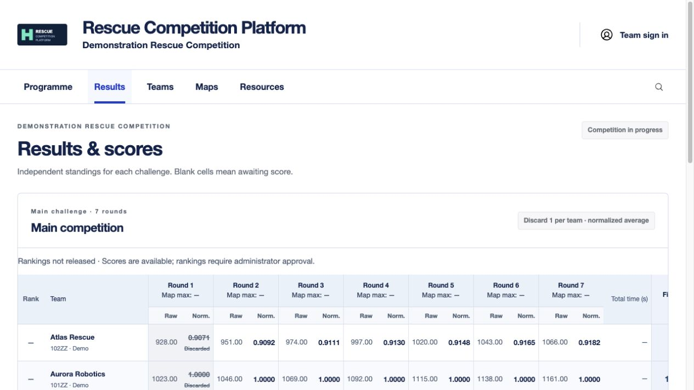
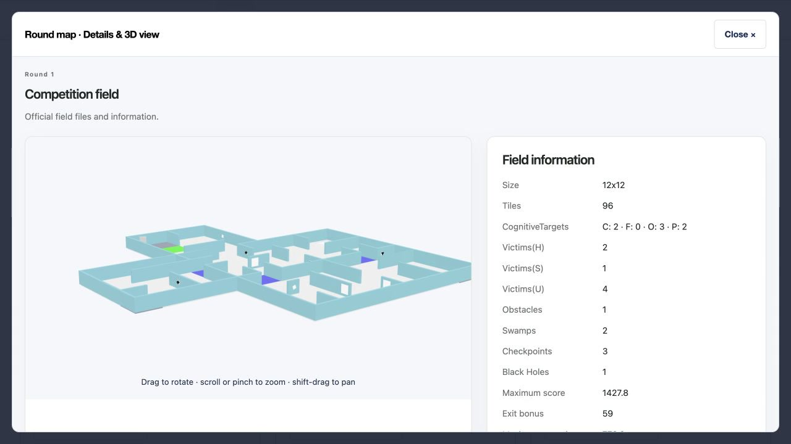
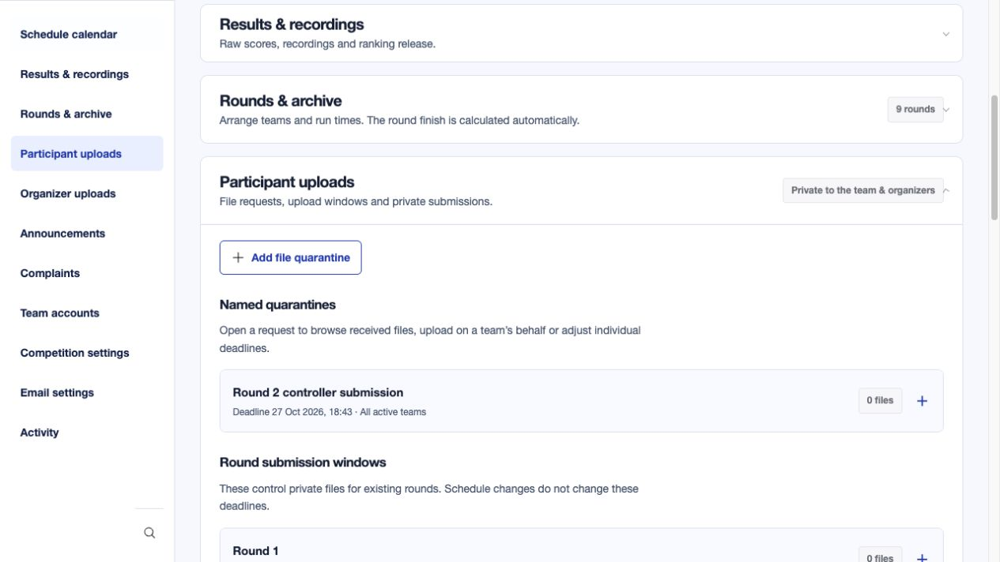

<h1 align="center">RoboCupJunior Rescue Simulation<br>Competition Platform</h1>

<p align="center"><strong>Developed by Peyman Yousefi</strong><br>For RoboCupJunior Rescue Simulation and similar competitions.</p>

<p align="center">
  <a href="LICENSE"></a>
  <a href="docs/SETUP.md"></a>
  <a href="requirements.runtime.lock"></a>
  <a href="compose.yaml"></a>
  <a href="https://github.com/peymanyousefi3/rcj-rescue-platform/actions/workflows/verify.yml"></a>
</p>

<p align="center">A web platform that helps organizers run a competition, gives teams a private workspace, and lets the public follow schedules, results and interactive match replays.</p>

<p align="center"><a href="#try-the-interactive-demo">Try the demo</a> · <a href="https://rcjrescue.com/">Live demonstration</a> · <a href="https://www.youtube.com/watch?v=qQhhGdPYHms">Watch the video</a> · <a href="#quick-start">Quick start</a> · <a href="#screenshots">Screenshots</a> · <a href="docs/DEPLOYMENT.md">Deployment</a></p>

## Key features

- **Interactive 3D replays:** watch Erebus/Webots recordings, rotate the scene and seek through the action in a browser.
- **Automatic results:** import a recording package to fill empty score and time fields.
- **Easy scheduling:** arrange team lineups and move rounds with drag and drop.
- **Flexible scoring:** choose scoring methods, discard rules and when rankings are released.
- **Private submissions:** collect team files with deadlines, upload locking and controlled access.
- **Competition tools:** publish maps, share organizer files, target announcements, manage teams and SuperTeams, and handle complaints.

## Try the interactive demo

**[Open the demo workspace](https://rcjrescue.com/demo/)** — use these public preview codes on the demo page only:

| Preview | Username | Password |
| --- | --- | --- |
| Admin | `demo_admin` | `RCJ-Admin-Preview-2026!` |
| Participant | `demo_participant` | `RCJ-Team-Preview-2026!` |

The clearly labelled demo includes a snapshot of publicly released ASR teams, scores, schedules and announcements, plus **nine interactive 3D fields and sixteen Webots match replays**. Explore the panels, rotate maps, play and seek recordings, open editors and preview calendar or score changes. Edits stay in the current page and reset on reload. Private workflow examples are illustrative.

**Public downloads are available:** released map JSON/WBT files and public replay packages. **Private team submissions are never included**: controller JSON, TDPs, internal videos and other private documents have no content or download links in the demo. Illustrative file names show how the workflow looks. There is no live account access, database saving, real upload processing or email delivery.

These are public preview codes, **not** credentials for the live admin or participant portal. The hosted demo is specific to RCJRescue.com; its implementation is separate from this repository and the `v1.0.0` release.

## See a demonstration

The platform was demonstrated for the **Junior Rescue Simulation League at RoboCup Americas Super Regional (ASR) 2026**. This is one example of its features in use.

**[View the demonstration at RCJRescue.com](https://rcjrescue.com/)** · **[Watch the 4-minute YouTube demonstration](https://www.youtube.com/watch?v=qQhhGdPYHms)**

[](https://www.youtube.com/watch?v=qQhhGdPYHms)

*Actual Rescue Simulation replay footage. Click the image to watch the demonstration. [Video chapters and English captions](docs/VIDEO.md).*

---

## Screenshots

Explore the platform from three perspectives. Replay and field images show actual Rescue Simulation footage; dashboard screenshots use fictional demonstration data.

### Public view

**Follow the competition from any browser.** Visitors can check the programme, see published scores and released rankings, and open interactive match replays from the schedule or beside a score.

- **Interactive 3D playback:** play, pause, seek, rotate the camera and use fullscreen without installing Webots. Replays open in a responsive popup; optional uploaded video is also supported.
- **Released maps:** inspect the 3D field, thumbnail and map information, and download the map JSON and WBT.
- **Competition updates:** browse public announcements, teams, main competition results and SuperTeam results on desktop or mobile.



<table>
<tr><td width="50%"><strong>Interactive match replay</strong></td><td width="50%"><strong>Released field and map information</strong></td></tr>
<tr><td></td><td></td></tr>
</table>

### Team view

**One private workspace for each team.** Participants see their upcoming runs, relevant announcements and organizer resources, with access controlled by the organizer.

- **Private multi-file submissions:** respond to named quarantine requests within upload windows; deadlines lock further changes.
- **Relevant resources:** access files and announcements addressed to the team, with permission changes applied immediately.
- **Team tools:** manage passwords, use shared SuperTeam workspaces, and submit private complaints with attachments and organizer responses.


### Admin view

**Set up the event once, then let connected workflows reduce repetitive work.** Manage teams, SuperTeams, challenges, rounds, uploads, communications and release decisions from the organizer panel.

- **Recording to results:** upload a complete Erebus/Webots folder or ZIP. Filenames and relative paths are preserved. Recording metadata fills empty score and time fields while preserving manual values; final scores already include bonuses. Older recordings remain playable without result metadata.
- **Lineup to schedule:** arrange teams with drag and drop, then place the round block in the calendar. Individual run times follow the lineup. Click to edit in a popup, drag to move, or select an empty interval to add an activity.
- **One score-entry matrix:** enter or paste team-by-round scores, undo changes and highlight missing values. Main and SuperTeam tables appear together. Review normalization, discards and final percentages, then explicitly release rankings.
- **Controlled collection and publication:** configure quarantine deadlines, browse participant files, upload map folders and choose when maps or recordings become public.
- **One record, many recipients:** publish multi-file organizer packages or announcements with searchable audience controls, optional personalized email and configurable CC/BCC.
- **Event administration:** configure dates, timezone, challenges, scoring policies, accounts, storage, email and activity records.

<table>
<tr><td width="50%"><strong>Results and recordings</strong><br>Scores, normalization, discards and ranking release.</td><td width="50%"><strong>Schedule calendar</strong><br>Round blocks, team lineups and daily planning.</td></tr>
<tr><td></td><td></td></tr>
<tr><td><strong>Announcements and recipients</strong><br>One announcement with its complete audience.</td><td><strong>Participant upload management</strong><br>Named quarantines, deadlines and private files.</td></tr>
<tr><td></td><td></td></tr>
</table>

## Capabilities

| Area | Included capabilities |
| --- | --- |
| **Public experience** | Competition programme, team roster, announcements, round results, released rankings, released maps and recording Play buttons beside scores and in the schedule. Responsive layouts and replay popups. |
| **Interactive recordings** | Folder and ZIP intake, nested replay-page detection, separate package storage, asset validation, preview detection, Webots controls, optional video, metadata extraction, final scores and time, exported timeline event display. |
| **Scoring** | Raw or normalized inputs; average after configurable lowest-score discards, sum, average or best scores; configurable top count and tie policy; zero-maximum round decisions; map maximum score from metadata; manual overrides and administrator-controlled rank release. |
| **Score entry** | Teams as rows, rounds as columns; Excel-style paste, Undo, missing scores, final percentage and rank; recordings attached to individual matches. Multiple challenge tables visible together. |
| **Rounds and maps** | Dynamic challenge categories, team lineup order, calculated round duration, whole-folder map detection, field information, thumbnail and GLB viewer. Controlled release; participant/public downloads expose the map JSON and WBT only. |
| **Participant uploads** | Named quarantine requests, all or selected teams, individual deadlines, multiple files, upload windows, locked changes after deadline, retained versions, checksums and private organizer access. |
| **Organizer uploads** | Multiple files under one subject, public or team audiences, one logical record with its recipients, immediate access changes when recipients are edited. |
| **Announcements** | Public, all-team or selected audiences; searchable recipient selection; bold text; optional personalized HTML email, additional email addresses and announcement CC/BCC settings. Dashboard publication does not require email. |
| **Team accounts** | Organizer-managed accounts, password setup/change/reset, optional authenticator enrollment, trusted-browser sign-in and private workspaces. SMTP must be configured for delivery of reset links. |
| **SuperTeams** | Group existing teams into challenge pairings; shared group workspace, submissions, rounds, schedules, maps and results alongside the main competition. |
| **Complaints** | Private complaint forms, attachments and organizer responses. |
| **Administration** | Event dates and timezone, challenges and calculation policies, searchable lists, popup editors, email/storage settings and activity records. |
| **Storage and operations** | Private local storage, optional S3-compatible or Google Drive storage, ClamAV scanning, background workers, PostgreSQL production database, authorization checks and audit records. Optional workbook-import compatibility; no sheet is required for dashboard-managed schedules or scores. |

### Default field scoring

For each round, divide a team's raw score by the highest raw score in that round. Discard the configured number of each team's **lowest normalized scores**, then average the retained normalized scores and multiply by 100. At least one round must remain. Calculations use full precision; only displayed values are rounded. Exact ties remain ties unless a tie-break policy is configured. A round with a zero maximum requires an organizer decision.

For example, `0.75, 1.00, 0.40, 0.80` with one discard produces **85%**. This is an average after discards, not a statistical median. Other challenge types can use their own configured policies.

### Privacy and release controls

Team uploads and private recordings are authorized server-side for the permitted team/group and organizers. Public availability is an explicit release choice. Removing a team from a shared organizer record removes its permission rather than leaving a separate recipient copy behind. Never serve private uploads directly as an unrestricted static directory.

## Quick start

Requires Docker with Compose and Python 3 for the configuration helper. For a Python-only development installation, see [Setup](docs/SETUP.md).

```sh
git clone https://github.com/peymanyousefi3/rcj-rescue-platform.git
cd rcj-rescue-platform
python3 scripts/configure_local.py
docker compose build
docker compose up -d db clamav
docker compose run --rm migrate
docker compose up -d app worker
docker compose exec app python manage.py bootstrap_event
docker compose exec app python manage.py createsuperuser
```

Open **http://127.0.0.1:8000/** and sign in with the administrator account you created. There are **no bundled login credentials**.

Optional, on a fresh demonstration installation only:

```sh
docker compose exec app python manage.py seed_demo
```

This adds fictional scores and SuperTeams; it creates no login accounts and sends no email. The original competition database, uploads and operational secrets are excluded.

## Architecture

| Layer | Technology |
| --- | --- |
| Application | Python 3.12, Django, server-rendered templates |
| Interactions | JavaScript, FullCalendar, SortableJS, model-viewer |
| Database | PostgreSQL in production; SQLite for local development |
| Background work | Django management worker, ClamAV scanning, queued email |
| Files | Authorized private storage; optional S3-compatible storage or Google Drive |
| Deployment | Docker Compose, Gunicorn and optional Caddy HTTPS proxy |

## Documentation

- [Setup and fictional demonstration](docs/SETUP.md)
- [HTTPS deployment, backups and upgrades](docs/DEPLOYMENT.md)
- [Security operations, resource limits and recovery](docs/SECURITY_OPERATIONS.md)
- [Security and private vulnerability reporting](SECURITY.md)
- [Contributing](CONTRIBUTING.md)
- [Project overview PDF](docs/PROJECT_OVERVIEW.pdf)
- [Release preparation checks](docs/RELEASE_CHECKS.md)
- [Video walkthrough, chapters and captions](docs/VIDEO.md)

## Credit and license

**Developed and maintained by Peyman Yousefi.** Built for **RoboCupJunior Rescue Simulation and similar competitions**. Demonstrated for the **Junior Rescue Simulation League at RoboCup Americas Super Regional 2026**, at [RCJRescue.com](https://rcjrescue.com/).

**Open-source edition:** the bundled dataset is fictional; private competition records and credentials are excluded. RCJRescue.com is an operating competition website.

Contributions are welcome through [pull requests](CONTRIBUTING.md). Changes require review by **Peyman Yousefi** and passing automated checks before they can be merged into `main`.

Project-owned code is available under the [MIT License](LICENSE). Copyright © 2026 Peyman Yousefi. See [attribution](NOTICE.md) and [third-party notices](THIRD_PARTY_NOTICES.md). Third-party software, trademarks, competition maps and recording packages retain their own rights; MIT does not grant rights to those materials.
