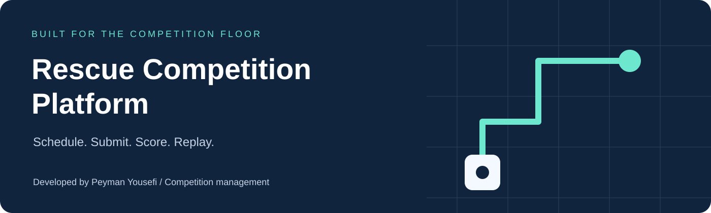
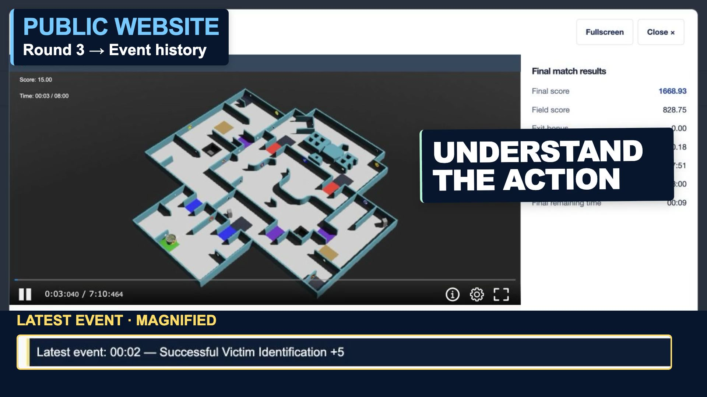
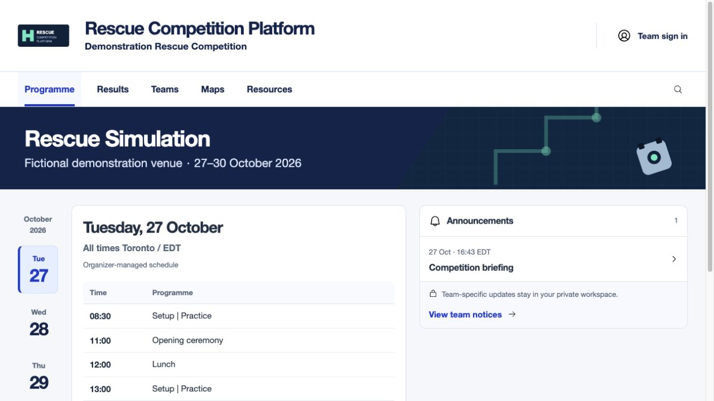
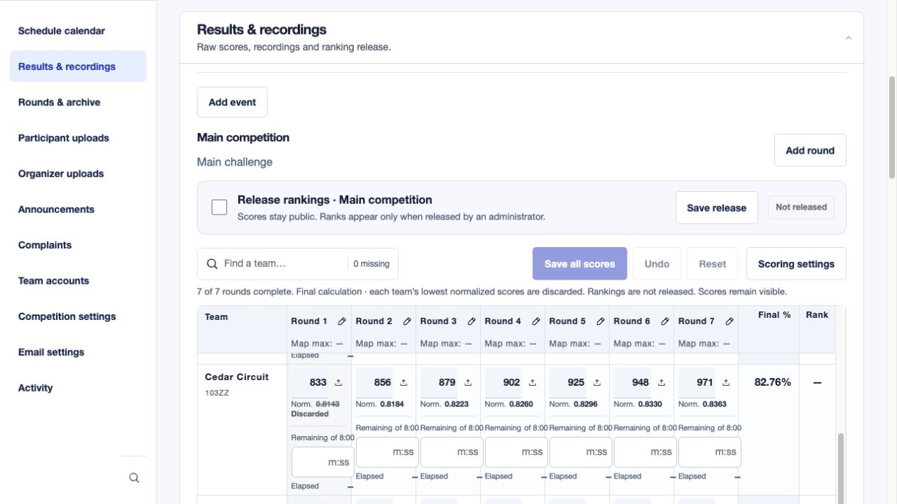
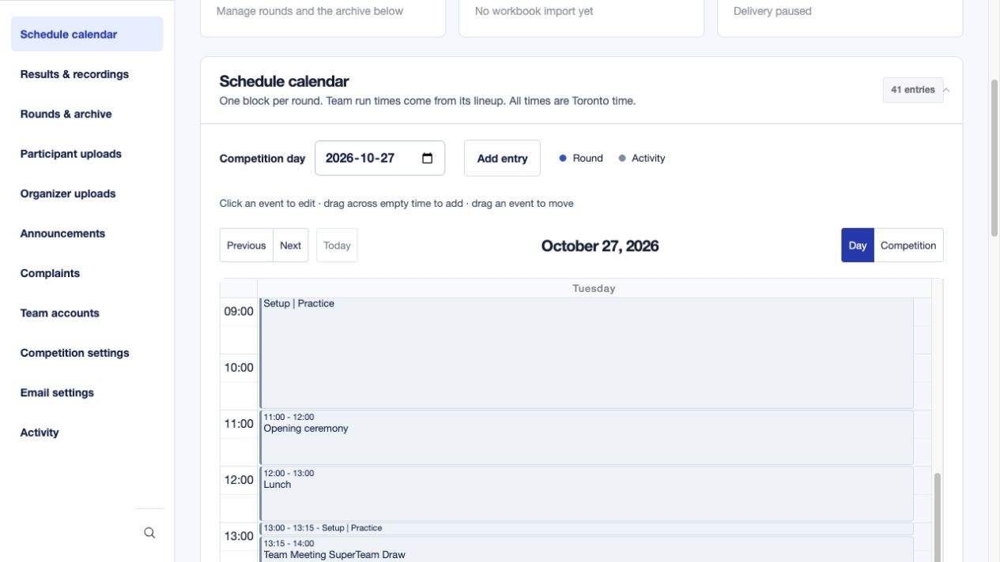
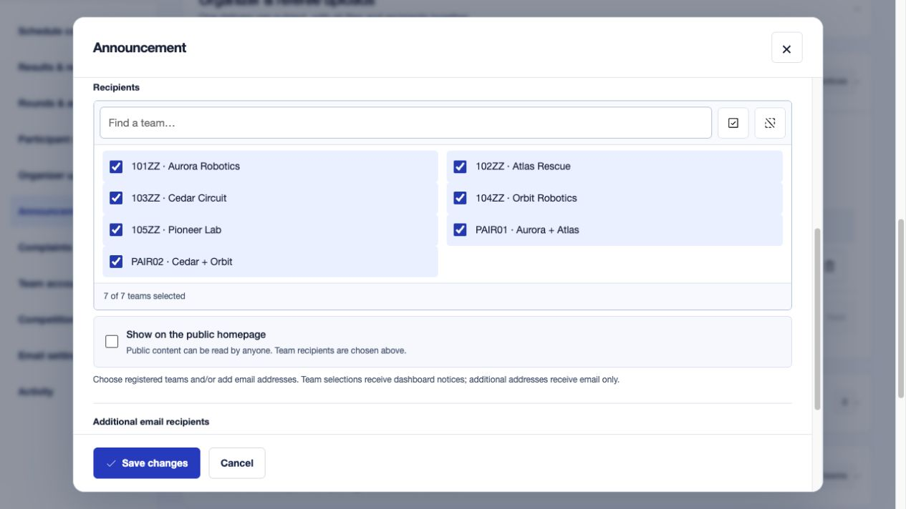
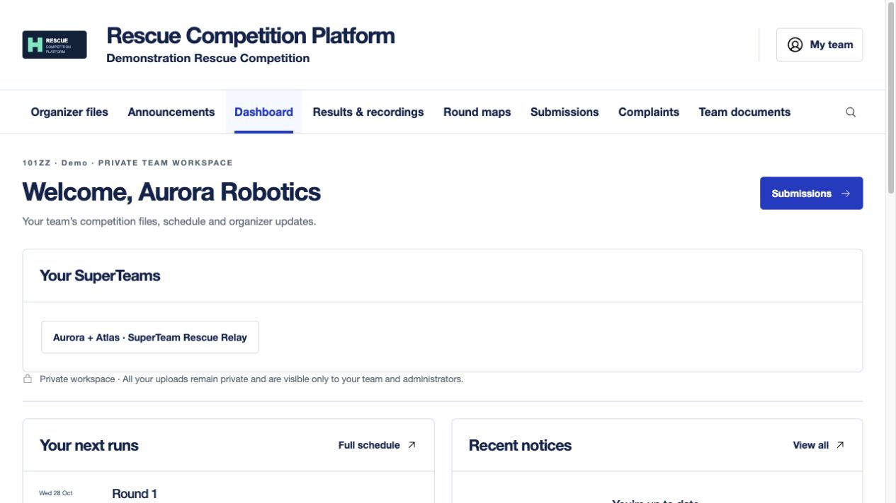

<p align="center">
  
</p>

<p align="center">
  <a href="LICENSE"></a>
  
  
  
</p>

<p align="center"><strong>One place to schedule the competition, protect submissions, publish results and replay every run.</strong></p>
<p align="center">Created and maintained by <strong>Peyman Yousefi</strong><br>Developed for and used in the RoboCupJunior Americas Super Regional 2026 Rescue Simulation competition.</p>
<p align="center"><a href="https://rcjrescue.com/">Deployed reference</a> · <a href="#the-workflow">Workflow</a> · <a href="#screenshots">Screenshots</a> · <a href="#quick-start">Quick start</a> · <a href="docs/DEPLOYMENT.md">Deployment</a> · <a href="https://www.youtube.com/watch?v=qQhhGdPYHms">Watch the video</a></p>

> **Private review edition.** This repository is prepared for open-source publication under MIT but remains private until the owner approves release. The source includes fictional demonstration data. The deployed reference is a real competition website, not a testing sandbox.

## Watch the platform in action

[](https://www.youtube.com/watch?v=qQhhGdPYHms)

**[Watch the 4-minute walkthrough on YouTube](https://www.youtube.com/watch?v=qQhhGdPYHms)** · [Chapters and English captions](docs/VIDEO.md)

Follow the public replay experience, then see how organizers import results, build schedules, release maps and manage private team workflows. Created and provided by **Peyman Yousefi**.

## The workflow

### Record once. Replay anywhere.

Upload a complete **Erebus/Webots recording folder or ZIP**. The platform preserves its HTML, scene, animation, textures and relative paths, and opens the interactive recording in a responsive popup. Visitors can replay, seek, rotate the camera and use fullscreen in their browser, without installing Webots. An uploaded video is also supported and takes precedence when present.

Recording metadata can **fill an empty score and time automatically**, preserving values already entered by an organizer. The exported `final_score` is the total; bonuses are not counted twice. Final results remain labelled as final results while the supplied player's synchronized event history follows playback and seeking. Older recordings remain playable when result metadata is absent.

### Arrange the round. Let the schedule follow.

Create a round, arrange its teams with drag and drop, and place the round block in the calendar. Individual run times come from the lineup. Click an event to edit in a popup, drag it to another time, or drag across an empty interval to add an activity. Switch between a day and the whole competition.

### Enter scores. Review. Release rankings.

Use one team-by-round matrix with **spreadsheet paste, Undo, missing-score highlighting and recording uploads inside each match cell**. Main competition and SuperTeam tables appear together. Raw and normalized scores, discarded rounds, time and final percentages stay visible. **Rankings require an explicit administrator release**, independently of public scores.

## Screenshots

Actual application screens captured from a local installation with fictional teams. No private competition accounts, submissions or contact information are shown.

### Public competition programme



<table>
<tr><td width="50%"><strong>Organizer score entry</strong><br>Raw scores, normalization, discards and ranking release.</td><td width="50%"><strong>Interactive schedule</strong><br>Round blocks and daily competition planning.</td></tr>
<tr><td></td><td></td></tr>
<tr><td><strong>Audience controls</strong><br>One announcement with its complete recipient list.</td><td><strong>Private team workspace</strong><br>Upcoming runs, resources and SuperTeam access.</td></tr>
<tr><td></td><td></td></tr>
</table>

[More: public results](docs/assets/public-results.jpg) · [Participant upload management](docs/assets/admin-quarantines.jpg)

## Capabilities

| Area | Included capabilities |
| --- | --- |
| **Public experience** | Competition programme, team roster, announcements, round results, released rankings, released maps and recording Play buttons beside scores and in the schedule. Responsive layouts and replay popups. |
| **Interactive recordings** | Folder and ZIP intake, nested replay-page detection, separate package storage, asset validation, preview detection, Webots controls, optional video, metadata extraction, final scores and time, exported timeline event display. |
| **Scoring** | Raw or normalized inputs; average after configurable lowest-score discards, sum, average or best scores; configurable top count and tie policy; zero-maximum round decisions; map maximum score from metadata; manual overrides and administrator-controlled rank release. |
| **Score entry** | Teams as rows, rounds as columns; Excel-style paste, Undo, missing scores, final percentage and rank; recordings attached to individual matches. Multiple challenge tables visible together. |
| **Rounds and maps** | Dynamic challenge categories, team lineup order, calculated round duration, whole-folder map detection, field information, thumbnail and GLB viewer. Controlled release; participant/public downloads expose the map JSON and WBT only. |
| **Participant uploads** | Named quarantine requests, all or selected teams, individual deadlines, multiple files, upload windows, locked changes after deadline, retained versions, checksums and private organizer access. |
| **Organizer uploads** | Multiple files under one subject, public or team audiences, one logical record with its recipients, immediate access changes when recipients are edited. |
| **Announcements** | Public, all-team or selected audiences; searchable recipient selection; bold text; optional personalized HTML email, additional email addresses and announcement CC/BCC settings. Dashboard publication does not require email. |
| **Team accounts** | Organizer-managed accounts, password setup/change/reset, optional authenticator enrollment, trusted-browser sign-in and private workspaces. SMTP must be configured for delivery of reset links. |
| **SuperTeams** | Group existing teams into challenge pairings; shared group workspace, submissions, rounds, schedules, maps and results alongside the main competition. |
| **Complaints** | Private complaint forms, attachments and organizer responses. |
| **Administration** | Event dates and timezone, challenges and calculation policies, searchable lists, popup editors, email/storage settings and activity records. |
| **Storage and operations** | Private local storage, optional S3-compatible or Google Drive storage, ClamAV scanning, background workers, PostgreSQL production database, authorization checks and audit records. Optional workbook-import compatibility; no sheet is required for dashboard-managed schedules or scores. |

### Default field scoring

For each round, divide a team's raw score by the highest raw score in that round. Discard the configured number of each team's **lowest normalized scores**, then average the retained normalized scores and multiply by 100. At least one round must remain. Calculations use full precision; only displayed values are rounded. Exact ties remain ties unless a tie-break policy is configured. A round with a zero maximum requires an organizer decision.

For example, `0.75, 1.00, 0.40, 0.80` with one discard produces **85%**. This is an average after discards, not a statistical median. Other challenge types can use their own configured policies.

### Privacy and release controls

Team uploads and private recordings are authorized server-side for the permitted team/group and organizers. Public availability is an explicit release choice. Removing a team from a shared organizer record removes its permission rather than leaving a separate recipient copy behind. Never serve private uploads directly as an unrestricted static directory.

## Quick start

Requires Docker with Compose and Python 3 for the configuration helper. For a Python-only development installation, see [Setup](docs/SETUP.md).

```sh
git clone https://github.com/peymanyousefi3/rcj-rescue-platform.git
cd rcj-rescue-platform
python3 scripts/configure_local.py
docker compose up -d --build
docker compose exec app python manage.py migrate
docker compose exec app python manage.py bootstrap_event
docker compose exec app python manage.py createsuperuser
```

Open **http://127.0.0.1:8000/** and sign in with the administrator account you created. There are **no bundled login credentials**.

Optional, on a fresh demonstration installation only:

```sh
docker compose exec app python manage.py seed_demo
```

This adds fictional scores and SuperTeams; it creates no login accounts and sends no email. The original competition database, uploads and operational secrets are excluded.

## Architecture

| Layer | Technology |
| --- | --- |
| Application | Python 3.12, Django, server-rendered templates |
| Interactions | JavaScript, FullCalendar, SortableJS, model-viewer |
| Database | PostgreSQL in production; SQLite for local development |
| Background work | Django management worker, ClamAV scanning, queued email |
| Files | Authorized private storage; optional S3-compatible storage or Google Drive |
| Deployment | Docker Compose, Gunicorn and optional Caddy HTTPS proxy |

## Documentation

- [Setup and fictional demonstration](docs/SETUP.md)
- [HTTPS deployment, backups and upgrades](docs/DEPLOYMENT.md)
- [Security and private vulnerability reporting](SECURITY.md)
- [Contributing](CONTRIBUTING.md)
- [Project overview PDF](docs/PROJECT_OVERVIEW.pdf)
- [Release preparation checks](docs/RELEASE_CHECKS.md)
- [Video walkthrough, chapters and captions](docs/VIDEO.md)


## Credit and license

**Created and maintained by Peyman Yousefi.** Developed for and used in the **ASR 2026 Junior Rescue Simulation competition**. [RCJRescue.com](https://rcjrescue.com/) is a deployed reference of the competition platform.

Project-owned code is available under the [MIT License](LICENSE). Copyright © 2026 Peyman Yousefi. See [attribution](NOTICE.md) and [third-party notices](THIRD_PARTY_NOTICES.md). Third-party software, trademarks, competition maps and recording packages retain their own rights; MIT does not grant rights to those materials.
