<h1 align="center">RoboCupJunior Rescue Simulation CRM</h1>

<p align="center"><strong>Developed by Peyman Yousefi</strong><br>For RoboCupJunior Rescue Simulation and similar competitions.</p>

<p align="center"><strong>Original repository:</strong> <a href="https://github.com/peymanyousefi3/rcj-rescue-platform">peymanyousefi3/rcj-rescue-platform</a></p>

<p align="center">
  <a href="https://github.com/peymanyousefi3/rcj-rescue-platform/blob/main/LICENSE"></a>
  <a href="https://github.com/peymanyousefi3/rcj-rescue-platform/blob/main/docs/SETUP.md"></a>
  <a href="https://github.com/peymanyousefi3/rcj-rescue-platform/blob/main/requirements.runtime.lock"></a>
  <a href="https://github.com/peymanyousefi3/rcj-rescue-platform/blob/main/compose.yaml"></a>
  <a href="https://github.com/peymanyousefi3/rcj-rescue-platform/actions/workflows/verify.yml"></a>
</p>

<p align="center">A web platform that helps organizers run a competition, gives teams a private workspace, and lets the public follow schedules, results and interactive match replays.</p>

## See it in action

<table>
<tr>
<td width="33%" align="center" valign="top">
<h3><a href="https://rcjrescue.com/">Live Website</a></h3>
<a href="https://rcjrescue.com/">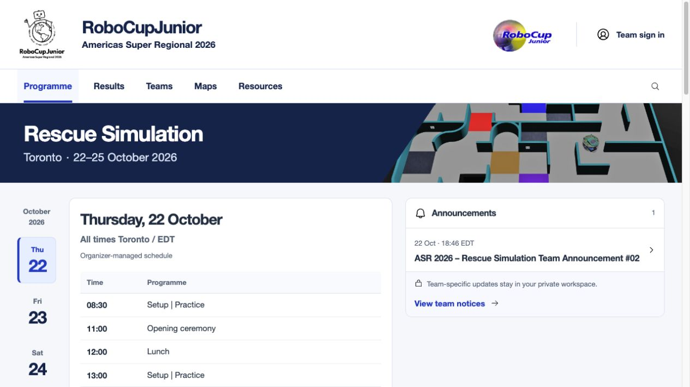</a>
<p>Explore the real ASR competition website.</p>
</td>
<td width="33%" align="center" valign="top">
<h3><a href="https://www.youtube.com/watch?v=qQhhGdPYHms">YouTube Video</a></h3>
<a href="https://www.youtube.com/watch?v=qQhhGdPYHms">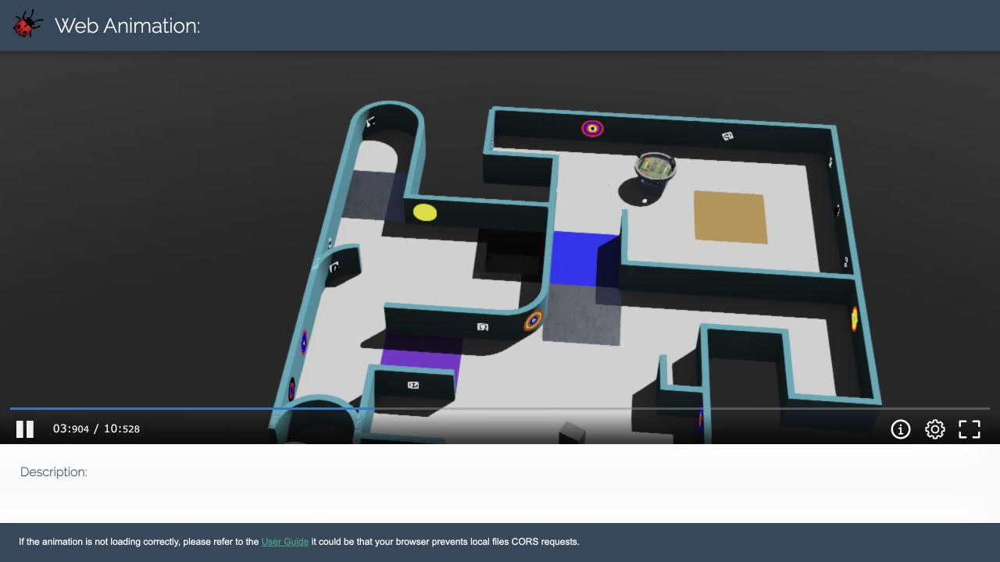</a>
<p>Watch the narrated platform walkthrough.</p>
</td>
<td width="33%" align="center" valign="top">
<h3><a href="https://rcjrescue.com/demo/">Interactive Demo</a></h3>
<a href="https://rcjrescue.com/demo/">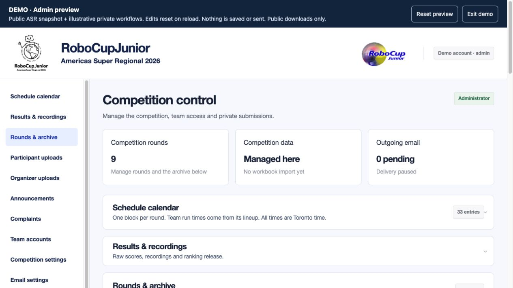</a>
<p>Try the admin and participant workspaces.</p>
</td>
</tr>
<tr>
<td width="33%" align="center"><a href="https://rcjrescue.com/"></a></td>
<td width="33%" align="center"><a href="https://www.youtube.com/watch?v=qQhhGdPYHms"></a></td>
<td width="33%" align="center"><a href="https://rcjrescue.com/demo/"></a></td>
</tr>
</table>

<p align="center"><strong>Interactive demo:</strong> edits reset on reload; nothing is saved or emailed.<br><a href="#try-the-interactive-demo"><strong>View demo usernames and passwords ↓</strong></a></p>

<p align="center">Demonstrated for the <strong>Junior Rescue Simulation League at RoboCup Americas Super Regional 2026</strong> — one example of the platform in use.</p>

<p align="center"><a href="#public-view">Animated feature tour</a> · <a href="#quick-start">Quick start</a> · <a href="https://github.com/peymanyousefi3/rcj-rescue-platform/blob/main/docs/DEPLOYMENT.md">Deployment guide</a></p>

## Key features

- **Interactive 3D replays:** watch Erebus/Webots recordings, rotate the scene and seek through the action in a browser.
- **Automatic results:** import a recording package to fill empty score and time fields.
- **Easy scheduling:** arrange team lineups and move rounds with drag and drop.
- **Flexible scoring:** choose scoring methods, discard rules and when rankings are released.
- **Venue screens:** loop the introduction, daily schedule and released results on TVs or projectors, updated automatically from the website.
- **Private submissions:** collect team files with deadlines, upload locking and controlled access.
- **Competition tools:** publish maps, share organizer files, target announcements, manage teams and SuperTeams, and handle complaints.

## Try the interactive demo

**[Open the demo workspace](https://rcjrescue.com/demo/)** — use these public preview codes on the demo page only:

| Preview | Username | Password |
| --- | --- | --- |
| Admin | `demo_admin` | `RCJ-Admin-Preview-2026!` |
| Participant | `demo_participant` | `RCJ-Team-Preview-2026!` |

Explore public ASR schedules, scores and announcements, **nine interactive 3D fields and sixteen match replays**, plus illustrative private workflows. Try editors and temporary calendar or score changes; reloading restores the preview.

**Demo only:** no live account access, database saving, real uploads or email. Public map/replay downloads are available; private controller JSON, TDPs, internal videos and team documents are excluded. These preview codes do not unlock the live portals. The hosted demo is separate from the source repository and stable release.

---

## Public view

### Watch the run. Explore the scene. Jump to the action.

Replays open beside a score or from the schedule in a responsive popup. Visitors can play, pause, seek, rotate the camera and use fullscreen without installing Webots. **Click an exported event to jump to its exact playback position.** Event text and match timestamps remain faithful to the recording, even where match time differs from playback time.

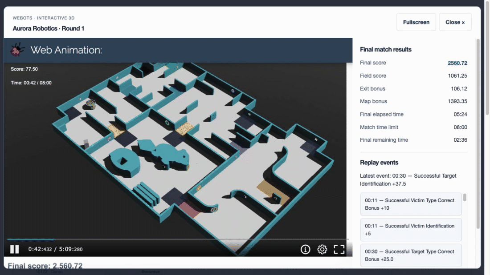

### Inspect the field before downloading the map

Published map packages include an interactive 3D field, preview and field information. Public map downloads expose the map JSON and WBT; supporting preview assets stay behind the viewer.

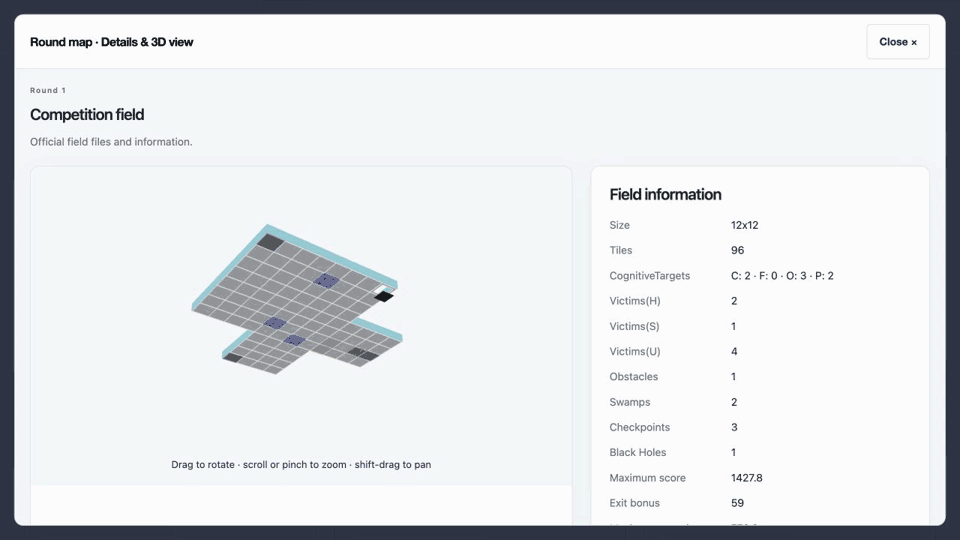

### Keep everyone in the venue up to date

Referees can open **`/slide`** in a browser and present it in fullscreen on venue **TVs or video projectors**. A continuous 16:9 loop shows the competition introduction, daily schedule and released results, so participants can follow updates without repeatedly checking their phones. Self-hosted fonts keep the slide typography consistent across display computers.

Names, logos, images, dates, round information and public scores follow the website automatically. The schedule uses the first scheduled day before the competition, the current day during it, and the final competition day afterward. **Private submissions stay private, and rankings appear only after organizer release.**

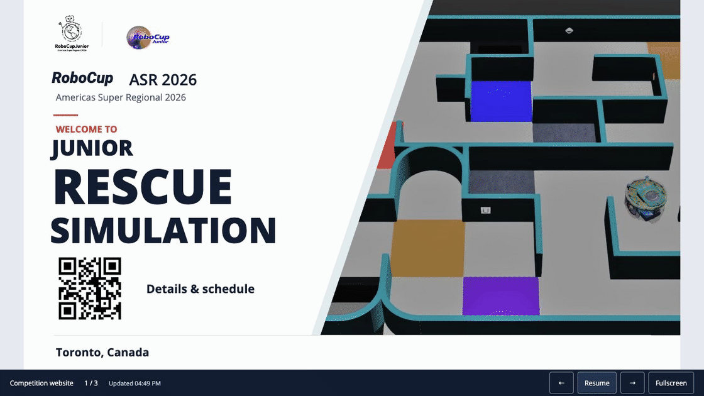

*Illustrative venue mockup with the actual platform slides.*

[Try the venue slideshow](https://rcjrescue.com/demo/slide.html) · [Configure the display](#a-live-display-without-duplicate-data-entry)

Also available: the competition programme, team roster, public announcements, round scores and **organizer-released rankings**, including SuperTeam results. Layouts adapt to desktop and mobile.

## Team view

### A private workspace with clear submission windows

Named requests tell teams what to submit and when. Multiple-file uploads, visible deadlines and locking help organizers collect the right files at the right time. Team documents and competition submissions remain separate from public materials.

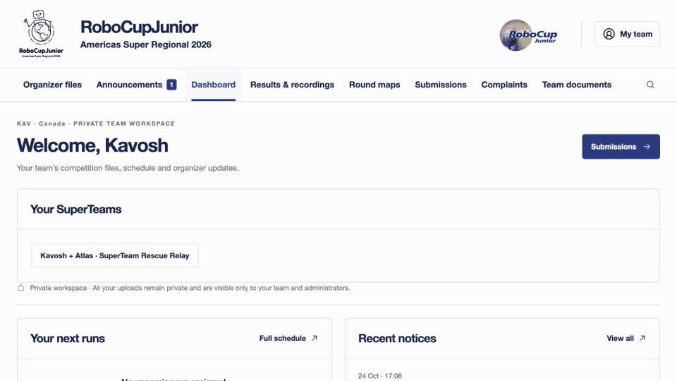

### Raise a concern at the exact moment

From their own replay, a team can open a private complaint with the run and playback position already filled in. Organizers can return directly to that moment. General complaints, evidence attachments and organizer responses remain available.

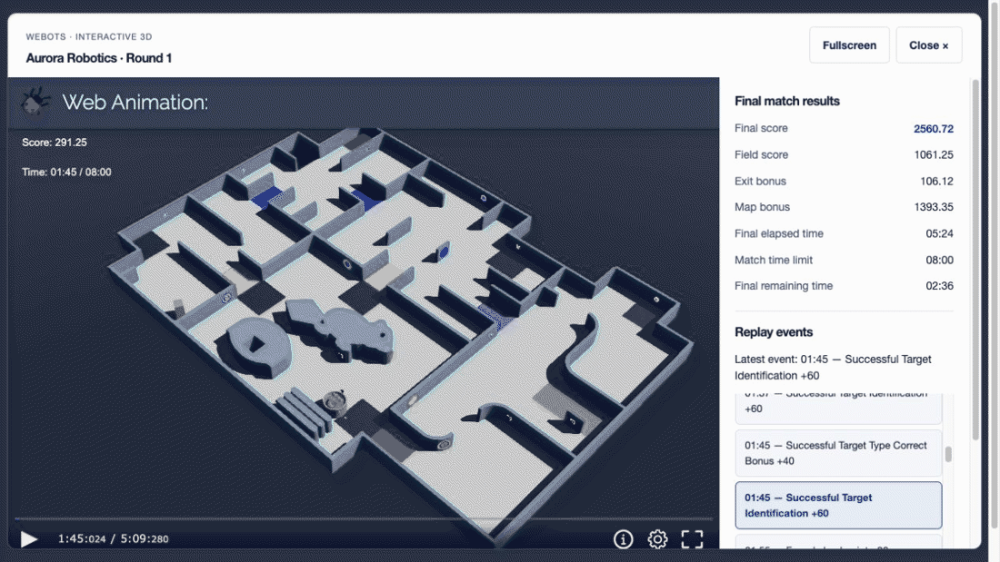

Teams also receive targeted announcements and organizer files, manage their passwords and access their existing SuperTeam workspace. Private files require authorized access; they are not part of the public demo.

## Admin view

### Recording package → replay, score and time

Upload a complete **Erebus/Webots folder or ZIP**, including nested packages. The platform preserves filenames and relative paths, validates supporting files and detects the preview. Metadata fills **empty score and time fields automatically**, preserving manual entries. The exported final score already includes bonuses, so bonuses are never added twice. Optional video uploads are supported; interactive recordings remain interactive.

Enter or paste scores across the entire team-by-round matrix, undo edits and spot missing values. Main competition and SuperTeam tables are available together. Normalization, lowest-score discards and final percentages recalculate while editing; **ranking publication stays an explicit organizer decision**.

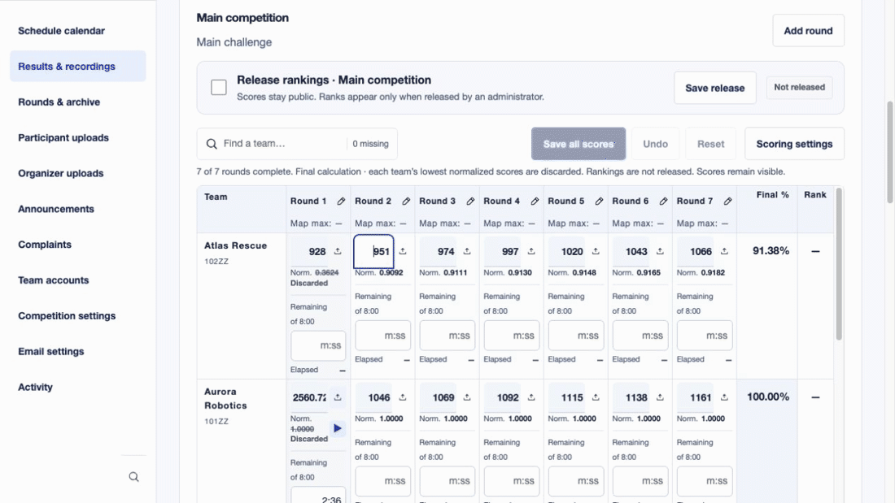

### Team lineup → competition calendar

Arrange team order and run times inside each round. The round duration is calculated from the lineup; placing one round block generates its team schedule. Drag activities, select time intervals and use popup editors instead of repetitive individual entry.

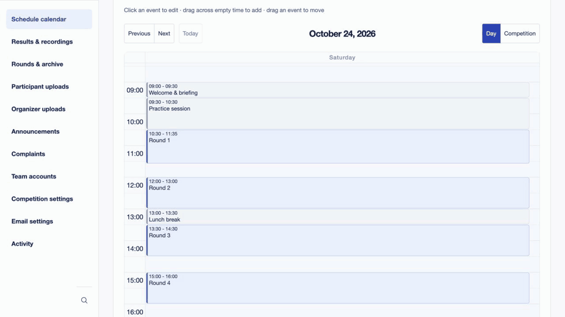

### Your competition, your identity

Configure the competition name, short name, header title, league, homepage banner title and subtitle, dates and location. Upload the competition logo, partner logo and banner image from the same settings popup. Current logos and the homepage image appear beside their replacement controls. The hosted demo retains the original RCJRescue/ASR identity; preview changes reset on reload.

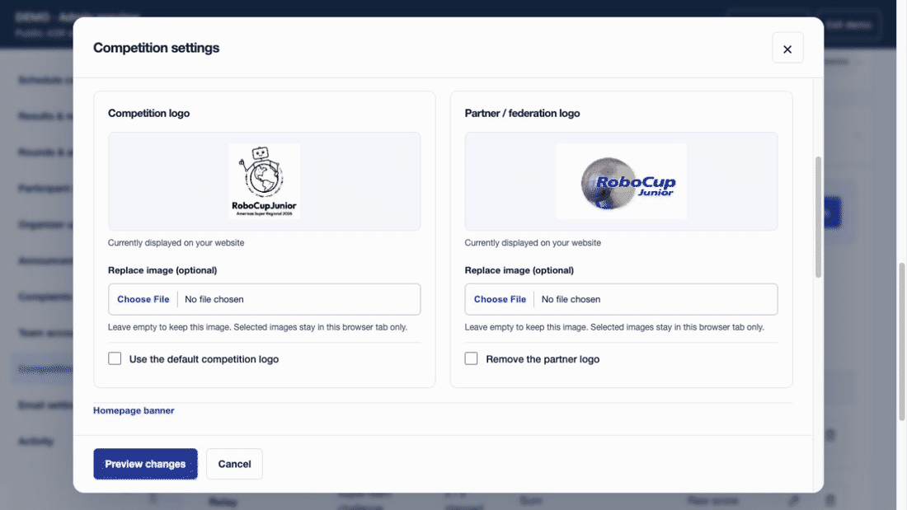

### A live display, without duplicate data entry

Configure the venue display under **Competition settings → Slideshow settings**. Set the introduction, schedule and results timings, automatic refresh frequency, colors, text and image overrides. Current logos and images appear in the editor before replacement.

Shared fields display their current website values; **Use website data automatically** keeps them linked to competition settings and branding. Clear it only for a slideshow-specific override. Changing an override does not alter the competition records. The [interactive demo](https://rcjrescue.com/demo/) lets you try these controls with temporary browser-only edits; reload restores the original settings.

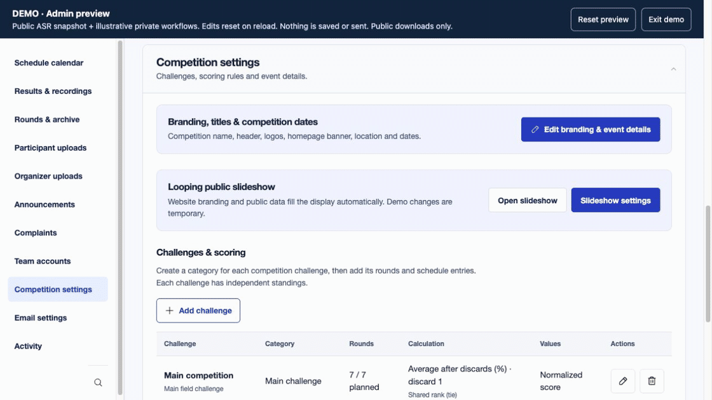

### One announcement. One audience. One record.

Search and select teams, choose public visibility, include additional email recipients and configure announcement CC/BCC. Optional personalized HTML emails accompany dashboard publication; the preview never sends them.

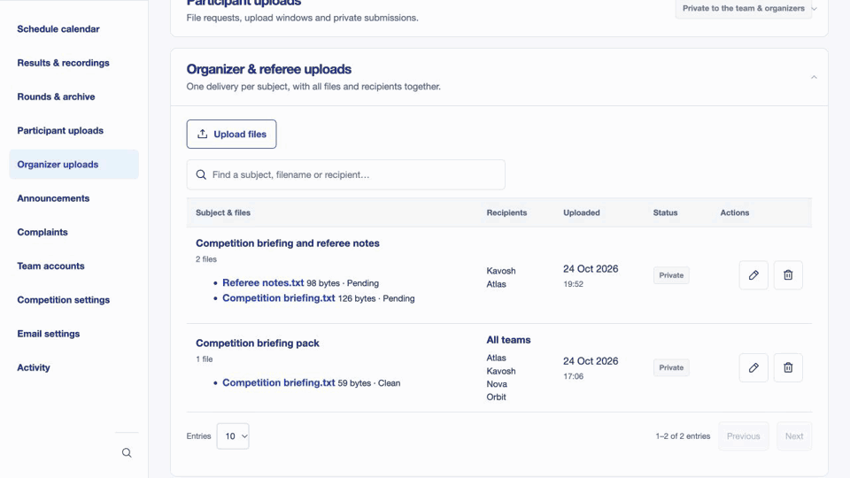

### Deliver files without duplicating records

Share multiple files under one subject and one recipient list. Editing that audience updates permission immediately; removing a team revokes access.

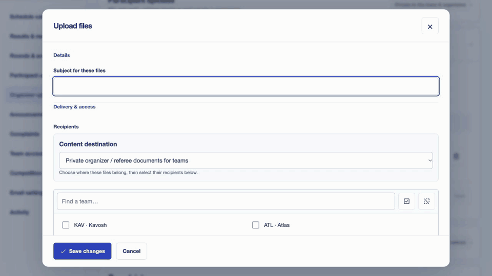

### Existing teams, shared SuperTeam challenges

Create pairings from existing teams, then manage their challenge rounds, maps, recordings, submissions and scores alongside the main competition.

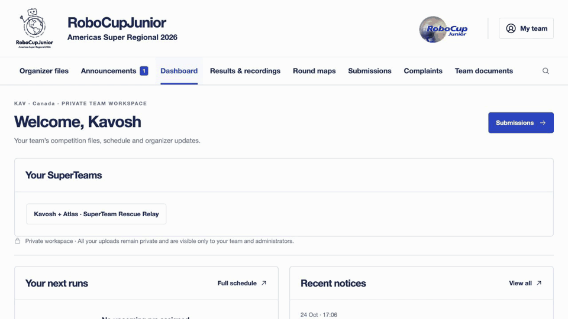

Organizers also configure scoring methods, quarantine windows and schedule-linked deadlines; browse private submissions; release maps early when appropriate; respond to complaints; manage accounts, storage and email; and review activity records.

---

## Capabilities

| Area | Included capabilities |
| --- | --- |
| **Public experience** | Competition programme, team roster, announcements, round results, released rankings, released maps and recording Play buttons beside scores and in the schedule. Responsive layouts and replay popups. |
| **Venue slideshow** | Fullscreen 16:9 introduction, date-aware daily schedule and complete public results for TVs and projectors. Automatic website data and branding, self-hosted fonts, configurable timings, refresh, colors and optional text/image overrides. |
| **Interactive recordings** | Folder and ZIP intake, nested replay-page detection, separate package storage, asset validation, preview detection, Webots controls, optional video, metadata extraction, final scores and time, exported timeline event display. |
| **Scoring** | Raw or normalized inputs; average after configurable lowest-score discards, sum, average or best scores; configurable top count and tie policy; zero-maximum round decisions; map maximum score from metadata; manual overrides and administrator-controlled rank release. |
| **Score entry** | Teams as rows, rounds as columns; Excel-style paste, Undo, missing scores, final percentage and rank; recordings attached to individual matches. Multiple challenge tables visible together. |
| **Rounds and maps** | Dynamic challenge categories, team lineup order, calculated round duration, whole-folder map detection, field information, thumbnail and GLB viewer. Controlled release; participant/public downloads expose the map JSON and WBT only. |
| **Participant uploads** | Named quarantine requests, all or selected teams, individual deadlines, multiple files, upload windows, locked changes after deadline, retained versions, checksums and private organizer access. |
| **Organizer uploads** | Multiple files under one subject, public or team audiences, one logical record with its recipients, immediate access changes when recipients are edited. |
| **Announcements** | Public, all-team or selected audiences; searchable recipient selection; bold text; optional personalized HTML email, additional email addresses and announcement CC/BCC settings. Dashboard publication does not require email. |
| **Team accounts** | Organizer-managed accounts, password setup/change/reset, optional authenticator enrollment, trusted-browser sign-in and private workspaces. SMTP must be configured for delivery of reset links. |
| **SuperTeams** | Group existing teams into challenge pairings; shared group workspace, submissions, rounds, schedules, maps and results alongside the main competition. |
| **Complaints** | Private forms, attachments, organizer responses and run-linked playback timestamps that open the exact replay moment. |
| **Administration** | Configurable competition identity, logos and homepage banner; event dates and timezone, challenges and calculation policies, searchable lists, popup editors, email/storage settings and activity records. |
| **Storage and operations** | Private local storage, optional S3-compatible or Google Drive storage, ClamAV scanning, background workers, PostgreSQL production database, authorization checks and audit records. Optional workbook-import compatibility; no sheet is required for dashboard-managed schedules or scores. |

### Default field scoring

For each round, divide a team's raw score by the highest raw score in that round. Discard the configured number of each team's **lowest normalized scores**, then average the retained normalized scores and multiply by 100. At least one round must remain. Calculations use full precision; only displayed values are rounded. Exact ties remain ties unless a tie-break policy is configured. A round with a zero maximum requires an organizer decision.

For example, `0.75, 1.00, 0.40, 0.80` with one discard produces **85%**. This is an average after discards, not a statistical median. Other challenge types can use their own configured policies.

### Privacy and release controls

Team uploads and private recordings are authorized server-side for the permitted team/group and organizers. Public availability is an explicit release choice. Removing a team from a shared organizer record removes its permission rather than leaving a separate recipient copy behind. Never serve private uploads directly as an unrestricted static directory.

## Quick start

Requires Docker with Compose and Python 3 for the configuration helper. For a Python-only development installation, see [Setup](https://github.com/peymanyousefi3/rcj-rescue-platform/blob/main/docs/SETUP.md).

```sh
git clone https://github.com/peymanyousefi3/rcj-rescue-platform.git
cd rcj-rescue-platform
python3 scripts/configure_local.py
docker compose build
docker compose up -d db clamav
docker compose run --rm migrate
docker compose up -d app worker
docker compose exec app python manage.py bootstrap_event
docker compose exec app python manage.py createsuperuser
```

Open **http://127.0.0.1:8000/** and sign in with the administrator account you created. There are **no bundled login credentials**.

Optional, on a fresh demonstration installation only:

```sh
docker compose exec app python manage.py seed_demo
```

This adds fictional scores and SuperTeams; it creates no login accounts and sends no email. The original competition database, uploads and operational secrets are excluded.

## Architecture

| Layer | Technology |
| --- | --- |
| Application | Python 3.12, Django, server-rendered templates |
| Interactions | JavaScript, FullCalendar, SortableJS, model-viewer |
| Database | PostgreSQL in production; SQLite for local development |
| Background work | Django management worker, ClamAV scanning, queued email |
| Files | Authorized private storage; optional S3-compatible storage or Google Drive |
| Deployment | Docker Compose, Gunicorn and optional Caddy HTTPS proxy |

## Documentation

- [Competition branding and replay-event controls](https://github.com/peymanyousefi3/rcj-rescue-platform/blob/main/docs/BRANDING.md)

- [Setup and fictional demonstration](https://github.com/peymanyousefi3/rcj-rescue-platform/blob/main/docs/SETUP.md)
- [HTTPS deployment, backups and upgrades](https://github.com/peymanyousefi3/rcj-rescue-platform/blob/main/docs/DEPLOYMENT.md)
- [Security operations, resource limits and recovery](https://github.com/peymanyousefi3/rcj-rescue-platform/blob/main/docs/SECURITY_OPERATIONS.md)
- [Security and private vulnerability reporting](https://github.com/peymanyousefi3/rcj-rescue-platform/blob/main/SECURITY.md)
- [Contributing](https://github.com/peymanyousefi3/rcj-rescue-platform/blob/main/CONTRIBUTING.md)
- [Project overview PDF](https://github.com/peymanyousefi3/rcj-rescue-platform/blob/main/docs/PROJECT_OVERVIEW.pdf)
- [Release preparation checks](https://github.com/peymanyousefi3/rcj-rescue-platform/blob/main/docs/RELEASE_CHECKS.md)
- [Video walkthrough, chapters and captions](https://github.com/peymanyousefi3/rcj-rescue-platform/blob/main/docs/VIDEO.md)

## Credit and license

**Developed and maintained by Peyman Yousefi.** Built for **RoboCupJunior Rescue Simulation and similar competitions**. Demonstrated for the **Junior Rescue Simulation League at RoboCup Americas Super Regional 2026**, at [RCJRescue.com](https://rcjrescue.com/).

**Open-source edition:** the bundled dataset is fictional; private competition records and credentials are excluded. RCJRescue.com is an operating competition website.

Contributions are welcome through [pull requests](https://github.com/peymanyousefi3/rcj-rescue-platform/blob/main/CONTRIBUTING.md). Changes require review by **Peyman Yousefi** and passing automated checks before they can be merged into `main`.

**Copyright © 2026 Peyman Yousefi.**

**Original repository:** [peymanyousefi3/rcj-rescue-platform](https://github.com/peymanyousefi3/rcj-rescue-platform).

Project-owned code is licensed under the [MIT License](https://github.com/peymanyousefi3/rcj-rescue-platform/blob/main/LICENSE).

**Preserving the original notice.** The copyright notice and MIT permission notice must be included in all copies or substantial portions of the software, as required by the license. When copying, modifying or redistributing this project, retain the original copyright notice naming **Peyman Yousefi** and the MIT license text. You may add copyright notices for your own contributions; do not remove or replace the original notice for portions retained from this project.

**Attribution request.** For forks, adaptations and redistributed versions, please also retain the original repository link and acknowledge **Peyman Yousefi** in your README or accompanying documentation. This is a professional courtesy request, not an additional condition of the MIT License.

See [attribution](https://github.com/peymanyousefi3/rcj-rescue-platform/blob/main/NOTICE.md) and [third-party notices](https://github.com/peymanyousefi3/rcj-rescue-platform/blob/main/THIRD_PARTY_NOTICES.md). Third-party software, trademarks, competition maps and recording packages retain their own rights; MIT does not grant rights to those materials.
